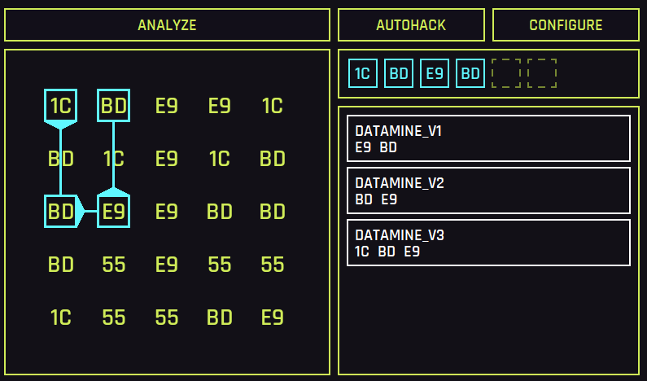

# CPAH 2.5 — Cyberpunk 2077 Autohacker

## About

CPAH 2.5 helps you solve Breach Protocol puzzles in Cyberpunk 2077. It builds on Joshua Chen’s original Cyberpunk 2077 Autohacker.

## What's New in CPAH 2.5

- **Game compatibility** — Updated for the current version of Cyberpunk 2077.
- **Turkish language support** — Added a Turkish translation of the app.

<table>
  <tr>
    <th>Screenshot</th>
    <th>Demo Video</th>
  </tr>
  <tr>
    <td align="center">
      
    </td>
    <td align="center">
      <video src="https://github.com/user-attachments/assets/3c31665e-8cd1-457b-9796-41b4f7ca241f" width="400" controls></video>
       
    </td>
  </tr>
</table>

## Credits

The original Cyberpunk 2077 Autohacker was created by Joshua Chen (`jkchen2`). [Original CPAH Project](https://gitlab.com/jkchen2/cpah).
